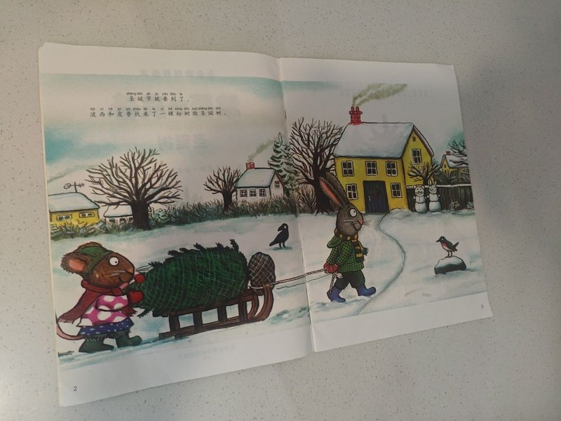
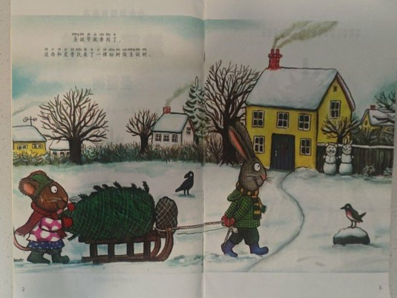
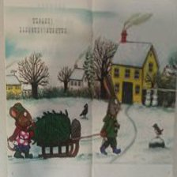

# DocFlatten ESP32-S3

基于 **esp-tflite-micro** 和 **esp_new_jpeg** 的文档四角检测与透视展平示例。输入一张 JPG 图片，检测图中的文档，并把文档区域透视拉伸成端正的矩形图片；输出尺寸与输入图片相同。整个模块只依赖 JPG 字节，不依赖任何特定型号的摄像头。

## 功能

- 输入图片，输出文档四角的归一化坐标（`左上、右上、右下、左下`）。
- 输入图片和四个角点，输出透视展平后的 JPG。
- 一步完成检测和展平。
- 示例程序从 SPIFFS 读取图片，逐张处理，打印各阶段耗时，保存结果，并可通过串口把结果传回电脑。
- 包含 800px 和 224px 两套输入目录和对应命令，用于对比分辨率和耗时（样例图片默认不提交，见下文）。

## 模型输入

当前 `doc_corner_int8.tflite` 的输入为：

```text
input : [1, 224, 224, 3] int8, scale=0.0078431377, zero_point=-1
output: coords[1, 8] int8, scale=0.0044970233, zero_point=-109
        logit [1, 1] int8, scale=0.0666234791, zero_point=-59
```

模型输入是 **224×224**，不是 192×192。角点顺序固定为：

```text
左上 top_left -> 右上 top_right -> 右下 bottom_right -> 左下 bottom_left
```

坐标是相对原图宽高的归一化值 `[0, 1]`。

模型文件通过 ESP-IDF 的 `EMBED_FILES` 嵌入固件，不再生成 `model_data.cc`。`main.cpp` 会把嵌入的模型复制到 **16 字节对齐的 PSRAM** 后再交给 TFLite，因为 `EMBED_FILES` 不保证模型起始地址满足 TFLite 的对齐要求。

## 目录结构

```text
main/
  document_corner.h / document_corner.cpp    # 文档四角检测
  image_preprocessor.h / image_preprocessor.cpp  # 缩放到 224 并量化
  document_geometry.h / document_geometry.cpp    # 单应矩阵 + 双线性透视展平
  document_flatten.h / document_flatten.cpp      # RGB/JPEG 展平接口
  document_pipeline.cpp                          # 检测 + 展平一体化流程
  image_codec.h / image_codec.cpp                # JPEG <-> RGB888
  file_storage.h / file_storage.cpp              # SPIFFS 文件/目录工具
  serial_transfer.h / serial_transfer.cpp        # base64 串口回传
  demo_runner.h / demo_runner.cpp                # 批量读取/处理/保存
  model_embedding.h                              # 嵌入模型的链接符号
  doc_corner_int8.tflite                         # 原始模型文件（EMBED_FILES）
  main.cpp                                       # 示例程序入口
tools/
  serial_receive.py                              # 串口 RUN/PULL 与结果保存
  serial_protocol.py                             # base64 协议解析与文件接收
flash_samples/
  sample/                                        # 800px 输入（默认不提交）
  sample224/                                     # 224x224 输入（默认不提交）
docs/
  images/                                        # README 示例图片
partitions.csv                                   # app 3MB + storage 12MB
sdkconfig.defaults                               # 16MB flash / 8MB PSRAM / UART0 921600
```

## 耗时分析

测试环境：ESP32-S3，240 MHz，8 MB PSRAM，ESP-IDF 5.3，JPEG 质量 85。耗时单位为毫秒/张。

### 800px 输入

处理耗时（`detect_and_flatten_document()` 内部，不含 SPIFFS 读写）：

| 阶段 | 平均耗时 | 占比 |
|---|---:|---:|
| JPEG 解码 | 104 ms | 7.7% |
| 检测（预处理 + 推理） | 369 ms | 27.3% |
| - 缩放到 224×224 + 量化 | 109 ms | 8.0% |
| - tflite 推理 | 261 ms | 19.3% |
| **透视展平（warp）** | **677 ms** | **50.1%** |
| JPEG 编码 | 201 ms | 14.9% |
| **处理合计** | **1351 ms** | **100%** |

端到端（含 SPIFFS 读取、写入、打印）约 **2.46 s/张**；其中文件 I/O 约 **1.1 s/张**，受 SPIFFS 空间和碎片影响较大。干净分区上 800px 的 71 张都能检测并写出；反复运行后空间不足可能出现 `short write`。

### 224px 输入

把图片在本地缩放到模型输入尺寸 224×224 后，处理耗时：

| 阶段 | 平均耗时 | 占比 |
|---|---:|---:|
| JPEG 解码 | 12 ms | 2.8% |
| 检测（预处理 + 推理） | 326 ms | 75.5% |
| - 缩放到 224×224 + 量化 | 65 ms | 15.1% |
| - tflite 推理 | 261 ms | 60.4% |
| 透视展平（warp） | 71 ms | 16.4% |
| JPEG 编码 | 23 ms | 5.3% |
| **处理合计** | **431 ms** | **100%** |

端到端（含 SPIFFS）约 **0.97 s/张**：

- SPIFFS 读取：约 5–8 ms
- SPIFFS 写入：约 **540 ms**
- 处理：约 431 ms

224px 下 71 张中有 1 张（`added_data_51`）得分降到 0.370，低于 0.5 阈值，因此只输出 70 张。缩小输入会损失少量检测精度。

### 两种尺寸对比

| 项目 | 800px | 224px | 变化 |
|---|---:|---:|---:|
| JPEG 解码 | 104 ms | 12 ms | 约 8.6× 更快 |
| 检测总耗时 | 369 ms | 326 ms | 约 1.13× 更快 |
| - 预处理 | 109 ms | 65 ms | 约 1.67× 更快 |
| - 推理 | 261 ms | 261 ms | 基本不变 |
| 透视展平 | 677 ms | 71 ms | 约 9.6× 更快 |
| JPEG 编码 | 201 ms | 23 ms | 约 8.8× 更快 |
| 处理合计 | 1351 ms | 431 ms | 约 3.1× 更快 |
| 端到端 | 2.46 s | 0.97 s | 约 2.5× 更快 |

**结论：**

1. 800px 时最大瓶颈是透视展平（约 50%），其次是模型推理和 JPEG 编码。
2. 224px 时推理固定为约 261 ms，成为处理阶段的主要耗时；warp 和 JPEG 编解码随分辨率下降明显。
3. 224px 端到端的主要耗时是 **SPIFFS 写入**（约 540 ms），比处理本身还长。如果追求速度，建议不要逐张写 SPIFFS，改为直接通过 USB/串口回传或使用更快的存储。
4. 224px 会损失少量检测精度；如果精度优先，建议保留 800px 输入，只优化 warp。
5. 模型复制到 PSRAM 后推理从约 281 ms 降到约 261 ms；代价是额外占用约 0.45 MB PSRAM。

## 在其他项目中使用

### 依赖

- ESP-IDF >= 5.0（本项目在 5.3 上验证；更早版本的 SPIFFS 头文件名可能是 `esp_vfs_spiffs.h`）
- `espressif/esp-tflite-micro`
- `espressif/esp_new_jpeg`
- PSRAM（模型、JPEG 解码、展平、编码缓冲区都放 PSRAM）
- `esp_timer`（耗时统计）

`idf_component.yml` 示例：

```yaml
dependencies:
  idf: ">=5.0.0"
  espressif/esp-tflite-micro: "^1.2.0"
  espressif/esp_new_jpeg: "^1.0.2"
```

核心库组件 `CMakeLists.txt`：

```cmake
idf_component_register(
    SRCS
        "document_corner.cpp"
        "document_flatten.cpp"
        "document_geometry.cpp"
        "document_pipeline.cpp"
        "image_codec.cpp"
        "image_preprocessor.cpp"
    INCLUDE_DIRS "."
    REQUIRES esp-tflite-micro esp_new_jpeg esp_timer
    EMBED_FILES "doc_corner_int8.tflite"
)
```

如果连同 Demo 的 `main.cpp` 一起使用，还需要 `spiffs`，并加入 `file_storage.cpp`、`serial_transfer.cpp`、`demo_runner.cpp`。

### 最小示例

```cpp
#include <cstring>

#include "document_flatten.h"
#include "esp_heap_caps.h"
#include "model_embedding.h"

extern const uint8_t *jpeg_data;
extern size_t jpeg_size;

void example() {
    const size_t model_length =
        static_cast<size_t>(document_corner_model_end - document_corner_model_start);

    // EMBED_FILES 不保证模型地址对齐；复制到 16 字节对齐的 PSRAM。
    uint8_t *aligned_model = static_cast<uint8_t *>(
        heap_caps_aligned_alloc(16, model_length, MALLOC_CAP_SPIRAM));
    if (!aligned_model) return;
    memcpy(aligned_model, document_corner_model_start, model_length);

    if (!document_flatten_initialize(aligned_model,
                                     static_cast<unsigned>(model_length),
                                     1024 * 1024)) {
        return;
    }

    uint8_t *output_jpeg = nullptr;
    size_t output_jpeg_length = 0;
    DocumentCornerResult corner_result = {};
    DocumentFlattenTimings timings = {};

    if (detect_and_flatten_document(jpeg_data, jpeg_size, &output_jpeg,
                                    &output_jpeg_length, &corner_result, 85,
                                    &timings)) {
        // output_jpeg 由 PSRAM 分配，使用完后必须释放。
        // ... 保存或发送 output_jpeg ...
        heap_caps_free(output_jpeg);
    }
}
```

### 公开 API

| 函数 | 说明 |
|---|---|
| `document_flatten_initialize(model_data, model_length, arena_size)` | 初始化内置检测器，`arena_size` 建议 1 MB。 |
| `document_flattener_is_ready()` | 检测器是否已初始化。 |
| `detect_and_flatten_document(jpeg, jpeg_length, &output_jpeg, &output_jpeg_length, &corner_result, quality, &timings)` | 检测 + 展平，输出 JPG 字节；未检测到文档返回 `false`。 |
| `flatten_document_jpeg(jpeg, jpeg_length, normalized_corners, &output_jpeg, &output_jpeg_length, quality)` | 已知角点时只做展平，输出 JPG 字节。 |
| `flatten_document_rgb_image(source_rgb, width, height, normalized_corners, output_rgb)` | RGB888 输入/输出，同尺寸展平。 |
| `DocumentCornerDetector::predict_corners(...)` | 只做角点检测，返回归一化坐标和置信度。 |
| `decode_jpeg_to_rgb_image()` / `encode_rgb_image_to_jpeg()` | 独立的 JPEG 编解码工具。 |

`normalized_corners` 是长度为 8 的 `float` 数组：

```cpp
float normalized_corners[8] = {
    top_left_x, top_left_y,
    top_right_x, top_right_y,
    bottom_right_x, bottom_right_y,
    bottom_left_x, bottom_left_y,
};
```

### 内存、线程和限制

- 检测器使用文件内静态实例，**不支持多线程并发推理**；多任务场景请自行加锁或一个任务一个实例。
- 模型副本约 0.45 MB PSRAM；输入 JPG、解码后的 RGB888、展平后的 RGB888、编码输出也都在 PSRAM。800×600 峰值约 6 MB，建议至少 6–7 MB 可用 PSRAM。
- 输出尺寸与输入图片相同。1600×1200 会超过 8 MB PSRAM，需要先缩小输入或改用更低分辨率的输出方案。
- `detect_and_flatten_document()` / `flatten_document_jpeg()` 返回的 `output_jpeg` 必须用 `heap_caps_free()` 释放。
- 有文档阈值 `DOCUMENT_SCORE_THRESHOLD` 默认 0.5，可在编译时覆盖：
  ```cmake
  target_compile_definitions(${COMPONENT_LIB} PRIVATE DOCUMENT_SCORE_THRESHOLD=0.4f)
  ```
- `document_corner.cpp` 会动态读取模型的输入尺寸、量化参数和输出张量；但算子解析器是固定的：
  `PAD / CONV_2D / DEPTHWISE_CONV_2D / TRANSPOSE / RESHAPE / FULLY_CONNECTED`。
  如果更换的模型使用其它算子，需要在 `DocumentCornerDetector::initialize()` 里补充 `resolver.Add...()`。
- 更换模型时，替换 `main/doc_corner_int8.tflite` 即可；如果文件名改变，需要同步修改 `main/CMakeLists.txt` 的 `EMBED_FILES` 和 `model_embedding.h` 中的符号名。不要忘记让模型数据保持 16 字节对齐（Demo 通过复制到 PSRAM 实现）。

## Demo 烧录与结果查看

### 硬件与环境

- ESP32-S3，**16 MB flash + 8 MB PSRAM**（本项目使用 OCT PSRAM、80 MHz）
- 串口：UART0，921600，开发板 CH343 串口（例如 `COM3`，按实际端口修改）
- ESP-IDF 5.3
- Python 3 + `pyserial`：
  ```powershell
  pip install pyserial
  ```

如果板子的 flash 只有 8 MB，需要同步修改 `partitions.csv` 和 `CONFIG_ESPTOOLPY_FLASHSIZE_8MB`，否则 12 MB 的 storage 分区放不下。

### 配置说明

- 默认控制台是 UART0，921600，GPIO43=TX、GPIO44=RX。如果板子的 UART0 引脚不同，修改 `sdkconfig.defaults` 中的 `CONFIG_ESP_CONSOLE_UART_TX_GPIO` / `CONFIG_ESP_CONSOLE_UART_RX_GPIO`。
- 默认 PSRAM 是 OCT + 80 MHz。如果是 QUAD PSRAM，把 `CONFIG_SPIRAM_MODE_OCT=y` 改成 `CONFIG_SPIRAM_MODE_QUAD=y`。
- 如果 921600 串口不稳定，可以把 `CONFIG_ESP_CONSOLE_UART_BAUDRATE`、`CONFIG_ESPTOOLPY_MONITOR_BAUD` 和命令里的 `-b` 改成 460800 或 115200。

### 准备 sample

仓库默认**不提交完整的 sample 图片**。使用前把自己的 JPG 放到：

```text
flash_samples/sample/       # 建议最长边 800px
flash_samples/sample224/    # 224x224，用于快速耗时测试
```

构建时会通过顶层 `CMakeLists.txt` 中的

```cmake
spiffs_create_partition_image(storage "${CMAKE_CURRENT_SOURCE_DIR}/flash_samples" FLASH_IN_PROJECT)
```

自动把 `flash_samples/` 打包成 SPIFFS 镜像，并随 `idf.py flash` 一起烧录到 `storage` 分区。目录中只保留 `.gitkeep` 时也能编译，但运行时 `RUN` 会提示没有图片。

仓库中的 `docs/images/` 只保留了几张 README 示例图，不代表完整数据集。如果只想提交少量 sample 图片，可以用 `git add -f <文件>` 强制加入，或调整 `.gitignore` 中 `flash_samples/**/*.jpg` 等规则。

### 编译与烧录

```powershell
idf.py set-target esp32s3
idf.py build
idf.py -p COM3 -b 921600 flash
```

或者直接编译并打开串口监视器：

```powershell
idf.py -p COM3 -b 921600 flash monitor
```

> 注意：如果工程路径包含中文，ESP-IDF/Ninja 可能出现反复全量编译或依赖跟踪异常。本项目实际构建时使用了纯 ASCII 路径；建议把工程放在 ASCII 路径下编译。

### 串口命令

程序启动后打印 `READY`，然后等待命令：

| 命令 | 作用 |
|---|---|
| `RUN` | 处理 `/spiffs/sample` 中的 JPG，结果写入 `/spiffs/out` |
| `RUN224` | 处理 `/spiffs/sample224` 中的 JPG，结果写入 `/spiffs/out224` |
| `PULL` | 用 base64 回传 `/spiffs/out` |
| `PULL224` | 用 base64 回传 `/spiffs/out224` |
| `INFO` | 打印 SPIFFS 空间和文件数量 |
| `ERASE` | 清空两个输出目录 |
| `REBOOT` | 重启 |

每张图片会打印：

```text
[12/71] xxx.jpg score=0.998 (...) time=1350.1 ms -> xxx_flat.jpg (80643 bytes)
  breakdown: decode=105.6 detect=363.2 (pre=102.6 infer=260.6) warp=675.5 encode=205.7 read=... write=... ms
```

### 把结果传回电脑

在项目根目录运行：

```powershell
# 800px：RUN + PULL，保存到 output/
python tools\serial_receive.py

# 224px：RUN224 + PULL224，保存到 output224/
python tools\serial_receive.py --set224 --output output224

# 只回传，不重新处理
python tools\serial_receive.py --skip-run

# 只处理，不回传（看耗时）
python tools\serial_receive.py --skip-pull
```

脚本会：

- 等待板子返回 `READY`；
- 发送 `RUN`/`RUN224`，等待 `RUN_DONE`；
- 发送 `PULL`/`PULL224`，解析 base64；
- 用文件头中的长度和 FNV-1a 校验值检查完整性；
- 把图片保存到 `output/` 或 `output224/`，日志保存为 `serial.log`。

可选参数：`--port COM3`、`--baud 921600`、`--output <目录>`、`--skip-run`、`--skip-pull`、`--set224`。

### 示例效果

输入（800px）：



800px 展平结果：



224px 展平结果（低分辨率，速度快）：



输出图片尺寸与输入一致：800px 样例输出为 800×600 或 600×800，224px 样例输出为 224×224。

## 已知问题与建议

- **SPIFFS 写入慢**：224px 输出约 10 KB 也要约 0.5 s；800px 输出约 70 KB 约 0.8–1 s。反复运行可能因 SPIFFS 空间不足出现 `short write`，先 `ERASE` 或重新烧录 storage 分区。
- **800px 输出较多时空间紧张**：71 张 800px 输出约 5 MB；`storage` 分区为 12 MB，扣除输入图片后余量有限。
- **224px 精度下降**：`added_data_51` 在 224px 下降至 0.370，未通过 0.5 阈值；800px 下 71/71 全部检测到。
- **模型对齐**：`EMBED_FILES` 生成的模型不保证 4/16 字节对齐，必须像 Demo 一样复制到对齐的 PSRAM 缓冲区；否则 TFLite 推理结果会异常（输出恒定、分数饱和）。
- **进一步提速方向**：
  - 800px：把 warp 改成定点整数运算，减少每像素浮点除法。
  - 224px：推理约 261 ms 固定；预处理可用查找表量化，进一步降低 65 ms。
  - 端到端：避免逐张写 SPIFFS，或改用更快的传输/存储方式。
